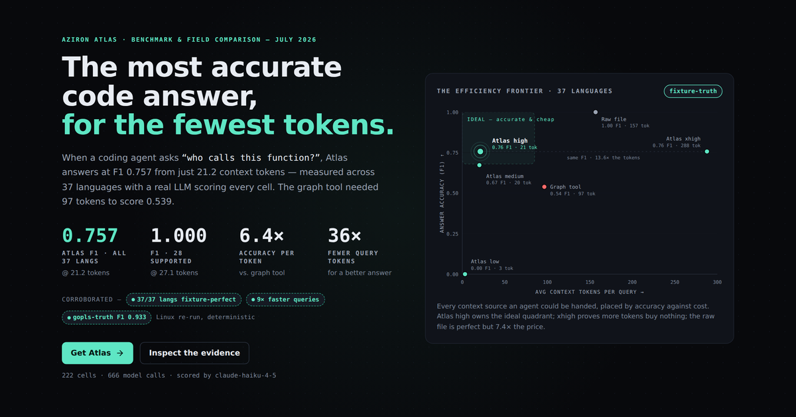
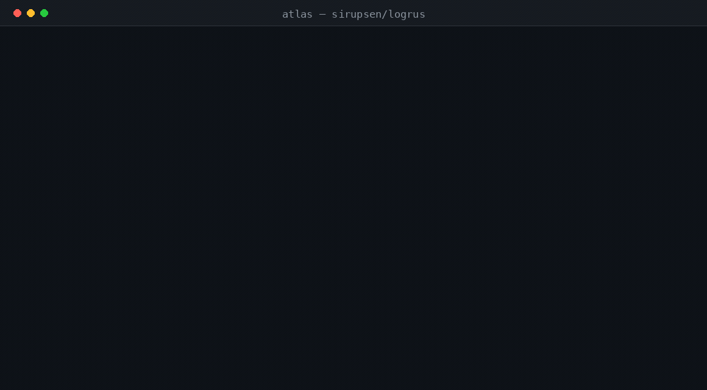
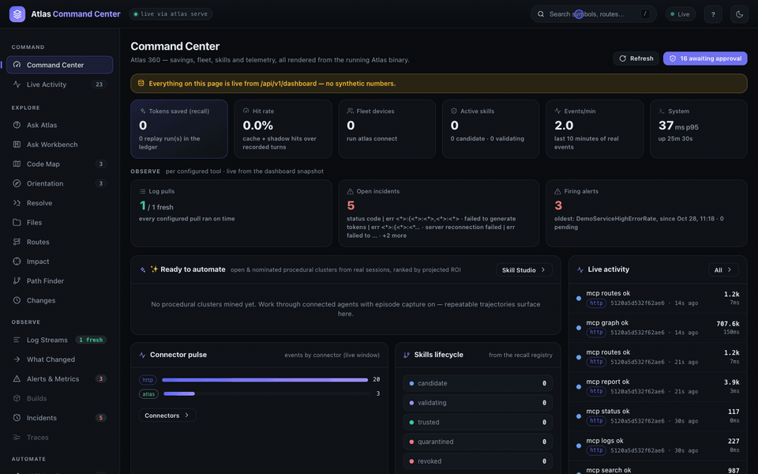
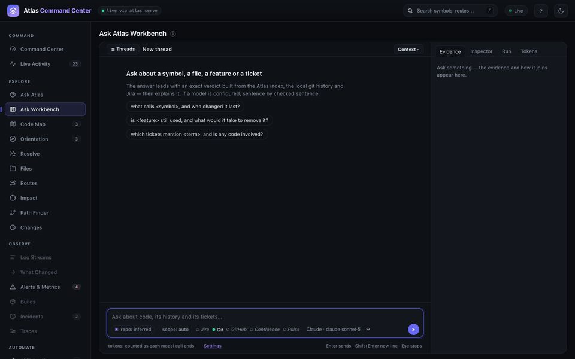

<p align="center">
  <a href="https://atlas.aziro.com/">
    
  </a>
</p>

<h1 align="center">Atlas</h1>

<p align="center">
  <strong>Stop pasting your codebase into the context window.</strong><br>
  Atlas gives you and your AI coding agent precise, <code>file:line</code>-cited answers about
  your code — who calls what, what breaks if this changes, which routes depend on a
  handler — for a fraction of the tokens it takes to read the files.
</p>

<p align="center">
  <a href="https://github.com/aziron-ai/atlas/releases"></a>
  <a href="LICENSE"></a>
  
  
  <a href="https://atlas.aziro.com/#benchmarks"></a>
</p>

<p align="center">
  <a href="https://atlas.aziro.com/#docs/getting-started">Documentation</a> ·
  <a href="https://atlas.aziro.com/#docs/installation">Install</a> ·
  <a href="https://github.com/aziron-ai/atlas/releases">Releases</a> ·
  <a href="https://atlas.aziro.com/#benchmarks">Benchmarks</a> ·
  <a href="https://github.com/aziron-ai/atlas/wiki">Wiki</a>
</p>

<p align="center">
  
</p>

<p align="center">
  ⭐ <strong>If Atlas saves your agent tokens (or your patience), a star helps others find it.</strong>
</p>

---

## Why Atlas

Coding agents answer code questions the expensive way: grep, then read whole
files into the context window, then guess. It burns tokens, dilutes the model's
attention, and still misses callers in files it never opened.

Atlas indexes your repo once and answers structural questions directly —
definitions, callers, references, routes, and change impact — returning a small,
**cited** slice of code instead of the whole file. Every answer points to
`file:line`, so you (or the agent) can verify the evidence.

It runs **locally**, is **deterministic** (no LLM in the loop, so the tool itself
spends zero tokens), and plugs into Claude, Codex, Cursor, Gemini, and Copilot
over MCP.

## The numbers

Measured on a public benchmark — 222 cells, 666 real LLM-scored model calls,
across 37 languages (refreshed 2026-08-05 at fc3b875, shipped in v0.1.51). Full
methodology and raw artifacts are
[published and reproducible](https://atlas.aziro.com/#benchmarks).

| Approach | Answer accuracy (F1) | Context tokens / query |
| --- | --- | --- |
| Read the whole file *(positive control — contains the answer by construction)* | 1.00 | 157 |
| Graph tool | 0.54 | 97 |
| **Atlas** | **0.86** — and **1.00 on 32 of 37 languages** | **24** |

<p align="center">
  <strong>3.17×</strong> fewer answer tokens &nbsp;·&nbsp;
  <strong>1.60×</strong> the caller F1 &nbsp;·&nbsp;
  <strong>4.12×</strong> faster queries &nbsp;·&nbsp;
  <strong>9.6×</strong> cheaper than max detail, same answer
</p>

The token and latency figures are pooled over a seven-repository matrix where both
binaries ran on one host in one pass, counting only queries **both** tools answered.
The raw-file row is a control, not a competitor: it contains the answer by
construction, so its 1.00 checks that the judge works.

> **Retracted.** Earlier READMEs claimed **36×** fewer query tokens (and before that,
> 20×) and **17×** faster queries. Those came from a live-repo run against a build
> whose caller answers were a two-token placeholder — across 224 answers it named
> zero callers. Withdrawn, not adjusted.

### Why not just read the files?

Ask **"who calls `WithField`?"** on [sirupsen/logrus](https://github.com/sirupsen/logrus),
scored against `gopls` call-hierarchy as ground truth:

A production function has callers spread across many files; raw dumps drown the model
in noise and still miss callers. Atlas returns the complete, precise caller set as
structured, cited context. What that is worth shows up inside a real agent loop —
19 questions, each agent restricted to one tool, `gopls` call-hierarchy as truth,
all 114 runs completed (2026-10-28, released Atlas 0.1.54, Claude Code 2.1.304 with
claude-sonnet-5, Codex CLI 0.162.1 with gpt-6.1-sol, graph tool graphify 0.8.49):

| Agent | Mode | Total tokens | Turns | Answer F1 | Wall time |
| --- | --- | ---: | ---: | ---: | ---: |
| claude | Graph tool | 251,586 | 7.6 | 0.233 | 33.4 s |
| claude | Grep-and-read baseline | 163,187 | 4.5 | 0.504 | 17.8 s |
| **claude** | **With Atlas** | **76,205** | **2.0** | **0.995** | **10.2 s** |
| codex | Graph tool | 155,242 | 5.2 | 0.275 | 19.2 s |
| codex | Grep-and-read baseline | 99,172 | 2.5 | 0.941 | 12.9 s |
| **codex** | **With Atlas** | **52,776** | **1.0** | **0.995** | **8.7 s** |

The baseline spends **2.14×** (claude) and **1.88×** (codex) Atlas's tokens; the graph
tool **3.30×** and **2.94×**. Cross-agent totals are not comparable — different
tokenizers and system-prompt floors — so compare modes within an agent. This run
replaces the 2026-08-05 table (2.32× / 4.10× claude, 2.22× / 3.92× codex, on Claude
Code 2.1.178 and Codex CLI 0.146.0-alpha.9.2 with gpt-5.6-sol). Atlas's F1 is unchanged
at 0.995. The harnesses' fixed token floors rose (+5,173 claude, +9,428 codex), which
pulls every ratio toward 1, and the newer codex is stronger without help; Atlas's own
per-question totals rose too, and the run does not isolate why. Both runs' per-run
records are in [data/raw/](data/raw/).

### Eight languages, both agents

The same harness on one pinned public repository per language — Go (logrus), Python
(requests), C (cJSON), Java (gson), C++ (leveldb), JavaScript (axios), TypeScript
(vue core) and Rust (ripgrep) — with each language's own server as ground truth:
**Atlas beats both the grep-and-read baseline and the graph tool, on accuracy and on
total tokens, in 16 of 16 agent × language cells** (912 runs, 2026-10-28, develop builds
that ship in 0.1.55; on cache-discounted billed-proxy tokens the graph tool is cheaper in
four codex cells, all listed on the site). Straight from the CLI with no agent, `atlas callers` scores F1
0.858–1.000 against those servers across the eight languages. Per-language tables:
[atlas.aziro.com/#agent-languages](https://atlas.aziro.com/#agent-languages).

### Asked in plain language

A labelled relevance benchmark — 216 natural-language questions over three frozen
corpora, three retrieval surfaces, 159 gated thresholds — measures where Atlas's
retrieval holds and where it does not yet, and publishes ten findings as follow-ups.
Results: [atlas.aziro.com/#relevance](https://atlas.aziro.com/#relevance); harness:
[relevance-bench/](relevance-bench/).

## Quickstart

Install with Homebrew:

```sh
brew install --cask aziron-ai/atlas/atlas
```

…or the npm wrapper:

```sh
npm install -g @aziron/atlas
```

Index a repository and wire Atlas into your coding assistants:

```sh
cd /path/to/repository
atlas index .
atlas bootstrap --dry-run   # preview assistant config changes
atlas bootstrap             # register MCP integrations
atlas status
```

That's it. Atlas can now answer questions like:

```sh
atlas search "checkout flow" --format plain   # where is it implemented?
atlas symbol CreateOrder                       # definition + callers + callees
atlas callers CreateOrder --limit 25           # who calls it?
atlas impact --paths services/cart.go          # what breaks if this changes?
```

The same answers are available to your coding assistant through Atlas's MCP
tools — with `file:line` citations on every result.

See [Getting Started](https://atlas.aziro.com/#docs/getting-started)
for a guided first index and first query.

## What Atlas provides

| Task | Capability |
| --- | --- |
| Find relevant code | Code-aware search and bounded context |
| Understand a symbol | Definitions, callers, callees, and references |
| Review a change | Repository and cross-repository impact analysis |
| Trace service dependencies | Routes, consumers, and dependencies |
| Support coding agents | MCP tools with source and line citations |
| Operate a local index | CLI status, dashboard, and HTTP API |
| Ask the codebase in plain language | Ask Workbench: a cited conversation in the dashboard, answered by a model you choose over evidence Atlas gathered |

Atlas runs locally by default and stores its index in the repository workspace.
No server is required for local indexing, CLI queries, or stdio MCP usage.

## Interfaces

- the `atlas` command-line interface
- MCP integrations for **Claude, Codex, Cursor, Gemini, and GitHub Copilot**
- a local dashboard and HTTP API, including the **Ask Workbench** — a conversation about
  the codebase where Atlas gathers the evidence (index, git, GitHub, Jira, Confluence,
  Pulse) and Claude or Codex writes the cited answer
- release archives and native Linux packages

Integration behavior varies by client — follow
[AI Assistant Setup](https://atlas.aziro.com/#docs/assistants)
for supported configurations.

## Install matrix

| Channel | Platforms |
| --- | --- |
| Homebrew cask | macOS and Linux, amd64 and arm64 |
| npm `@aziron/atlas` | macOS/Linux x64 and arm64; Windows x64 |
| Release archives | macOS/Linux amd64 and arm64; Windows amd64 |
| Linux packages | `.deb`, `.rpm`, and `.apk` for amd64 and arm64 |

Homebrew and npm installs run `atlas bootstrap` to register supported local
assistant integrations. Preview first with `atlas bootstrap --dry-run`, or skip
it in automation:

```sh
ATLAS_SKIP_BOOTSTRAP=1 npm install -g @aziron/atlas
```

Checksums and per-archive SBOMs are attached to every
[GitHub release](https://github.com/aziron-ai/atlas/releases).

## See it

Atlas running on the public Go project [inference-gateway](https://github.com/inference-gateway/inference-gateway): the header search finds a symbol and opens it in the inspector, and the Ask Workbench answers a question about the routes with every row cited.





The [user guide](https://atlas.aziro.com/#docs/tour) walks every surface with screenshots and clips.

## Documentation

User guide:

- [What Atlas does](https://atlas.aziro.com/#docs/tour) — one frame of every area
- [The dashboard](https://atlas.aziro.com/#docs/dashboard)
- [Code Map and graph](https://atlas.aziro.com/#docs/code-map)
- [Search and Ask](https://atlas.aziro.com/#docs/search-and-ask)
- [Ask Workbench](https://atlas.aziro.com/#docs/workbench)
- [Impact and review](https://atlas.aziro.com/#docs/impact)
- [Change lens and history](https://atlas.aziro.com/#docs/history)
- [Connected sources](https://atlas.aziro.com/#docs/sources)
- [Observe](https://atlas.aziro.com/#docs/observe)
- [Skills and automations](https://atlas.aziro.com/#docs/skills)
- [One Atlas for a team](https://atlas.aziro.com/#docs/teams)

Reference:

- [Getting Started](https://atlas.aziro.com/#docs/getting-started)
- [Installation](https://atlas.aziro.com/#docs/installation)
- [Indexing and Reindexing](https://atlas.aziro.com/#docs/indexing)
- [CLI Reference](https://atlas.aziro.com/#docs/cli)
- [AI Assistant Setup](https://atlas.aziro.com/#docs/assistants)
- [MCP Tools](https://atlas.aziro.com/#docs/mcp)
- [Dashboard and HTTP API](https://atlas.aziro.com/#docs/service)
- [Configuration](https://atlas.aziro.com/#docs/configuration)
- [Privacy and Data Handling](https://atlas.aziro.com/#docs/privacy)
- [Supported Languages](https://atlas.aziro.com/#docs/languages)
- [Benchmarks and Methodology](https://atlas.aziro.com/#docs/benchmarks)
- [Troubleshooting](https://atlas.aziro.com/#docs/troubleshooting)

The complete guide is also mirrored in the
[GitHub Wiki](https://github.com/aziron-ai/atlas/wiki).

## Benchmarks and data

The [benchmark explorer](https://atlas.aziro.com/#benchmarks) presents
dated accuracy, token-use, and latency measurements with limitations and
evidence levels. The underlying data is downloadable:

- [Processed site data](data/site-data.json)
- [Raw benchmark artifacts](data/raw/)
- [Agent benchmark reproduction guide](agent-bench/README.md) — logrus plus seven more languages
- [Relevance benchmark harness](relevance-bench/README.md)

Results describe the published test conditions and are not a guarantee for every
repository, language, machine, or coding assistant.

## Data handling

Indexing and querying run locally by default. An MCP client or coding assistant
may send the snippets it receives to its configured model provider, subject to
that client's data policy. Network listeners and optional connected features
require additional configuration. Review
[Privacy and Data Handling](https://atlas.aziro.com/#docs/privacy)
before enabling network access or organization-connected features.

## Star History

<a href="https://www.star-history.com/#aziron-ai/atlas&Date">
  
</a>

## Repository scope

This public repository distributes Atlas release binaries, consumer
documentation, the benchmark site, and downloadable benchmark artifacts. The
Atlas CLI source tree is not published here.

## License

Atlas is distributed under the [Apache License 2.0](LICENSE).
